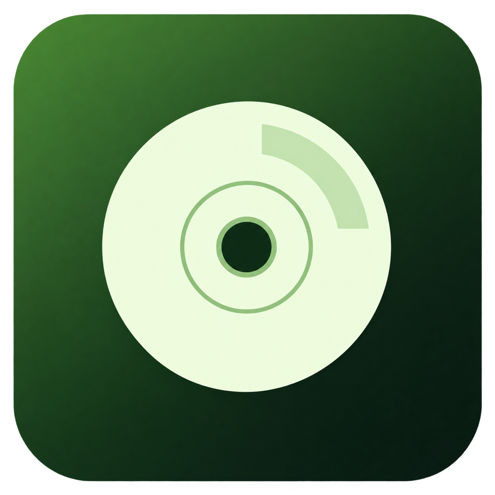

  
  <h1>Xiso Harbor</h1>
  
<strong>Turn Xbox disc images into game folders, right on your Mac.</strong>

  
Experimental &nbsp;·&nbsp; Apple Silicon &nbsp;·&nbsp; Offline &nbsp;·&nbsp; MIT

  

    <a href="https://github.com/Morteza-ap/xiso-harbor/releases/download/v1.0.2/Xiso-Harbor-macOS-arm64.zip"><strong>Download for Mac ↓</strong></a>
    &nbsp;·&nbsp; <a href="https://github.com/Morteza-ap/xiso-harbor/releases/tag/v1.0.2">Release notes</a>
    &nbsp;·&nbsp; <a href="#first-launch">First launch</a>
    &nbsp;·&nbsp; <a href="DEVELOPMENT.md">Build from source</a>
  

---

Xiso Harbor reads compatible Xbox and Xbox 360 ISO/XISO images and extracts their files into a folder you choose. A small, focused experiment: a native extraction engine, a quiet green interface, and everything processed on your Mac.

  

## Download and install

1. [Download the app ZIP](https://github.com/Morteza-ap/xiso-harbor/releases/download/v1.0.2/Xiso-Harbor-macOS-arm64.zip) from the **v1.0.2 experimental release**.
2. Double-click the ZIP to unpack **Xiso Harbor.app**.
3. Drag the app to **Applications**, then open it from Finder, Launchpad, or Spotlight.

**Requires an Apple Silicon Mac (M-series), macOS 12 or later, and space for the extracted files.** This build does not support Intel Macs. Testing covers one Apple Silicon environment; the full macOS version range has not been verified. No Terminal, developer tools, OpenAI account, or API key is needed to use the app.

The release includes a `SHA256SUMS.txt` file for checking download integrity. Choose the ZIP under **Assets**, rather than GitHub's automatically generated source-code archives.

### First launch

This experimental build is **ad-hoc signed and not notarized by Apple**. macOS may block the first launch because it cannot verify the developer. If you trust this download, try opening it once, then go to **System Settings → Privacy & Security → Open Anyway** and confirm **Open**. Older macOS versions call this panel **System Preferences → Security & Privacy → General**. Follow [Apple's guidance](https://support.apple.com/en-us/102445); a managed Mac may restrict this option.

Keep Gatekeeper enabled. If macOS reports malware or a damaged app, stop and report the problem rather than bypassing the warning. The app itself does not ask for administrator access; macOS may require your approval to make a first-launch exception or access a protected folder.

## How it works

1. Choose one `.iso` or `.xiso` image with **Browse**, or drop it into the app.
2. Choose a destination and review the suggested game-folder name.
3. Select **Extract**. Progress reflects bytes written, and you can cancel.
4. When verification finishes, select **Show in Finder**.

Raw XISO and the XGD1, XGD2, and XGD3 layouts supported by the extraction library are recognized. Extract each disc of a multi-disc game into its own folder. Xiso Harbor does not repair images, merge discs, set up a console, or execute extracted files. Use images you trust and are authorized to access.

## Your files stay local

**The app does not collect or send your images, extracted files, filenames, analytics, or telemetry to us.** There is no account, cloud extraction service, advertising, remote asset loading, or automatic update client. Extraction works offline.

To recover interrupted work, the app stores a small record in its local Application Support folder: the partial output folder's path and filesystem identity. Cancelled work remains in a marked `.partial` folder until you choose to keep or delete it. Session diagnostics stay in memory; copying a report is an action you choose. Review reports before posting them, since names from an image can appear in errors.

GitHub downloads, reports you choose to submit, and macOS security checks are handled by those services, outside the app. See [Privacy](docs/PRIVACY.md) for details.

## An experiment, with clear limits

This is an independent, community experiment with best-effort support. It is not an official Xbox or Microsoft product. Existing destinations are preserved, extraction uses a fixed-size copy buffer, and output file types and sizes are checked before completion.

Synthetic tests cover supported image layouts, more than 10,000 files, a file larger than 2 GiB, cancellation, recovery, and malformed metadata. No commercial game images were used. Size/type checks cannot prove an image is authentic, complete, or harmless. The app is not macOS App Sandbox enabled or security-certified, and we cannot promise safe extraction of every hostile image.

- [Release verification](docs/review/release-1.0.2.md)
- [Quality and security review](docs/QUALITY-SECURITY-REVIEW.md)
- [Security model and private vulnerability reporting](SECURITY.md)
- [Development and reproducible builds](DEVELOPMENT.md)

For ordinary bugs, [open an issue](https://github.com/Morteza-ap/xiso-harbor/issues). Please omit personal paths, private files, and game images. Report security concerns privately using [GitHub's vulnerability reporting](https://github.com/Morteza-ap/xiso-harbor/security/advisories/new).

## License and credits

Xiso Harbor's original code is available under the [MIT license](LICENSE), including commercial use, modification, and redistribution with the license notice preserved. It is provided without warranty.

The native extractor uses [antangelo/xdvdfs](https://github.com/antangelo/xdvdfs), pinned to 0.8.3. React and TypeScript provide the interface; Tauri and Rust handle the desktop app and local files. Third-party components retain their own licenses; [notices](THIRD_PARTY_NOTICES.md) and [dependency licenses](DEPENDENCY_LICENSES.md) are included in the source and app bundle.

---

One disc image. One folder. A little green nostalgia.

