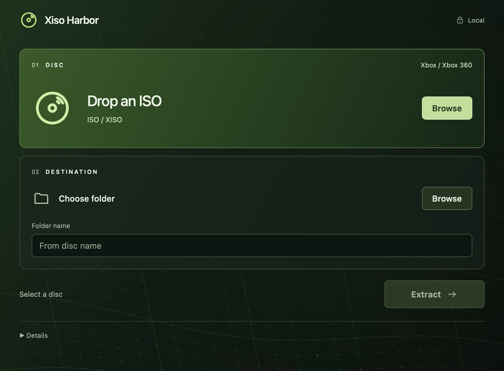
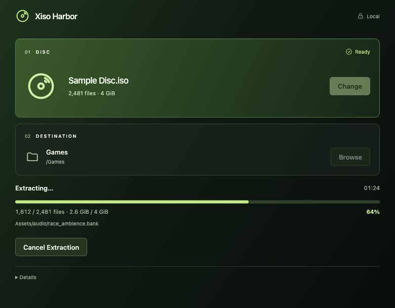

# Minimal console UI — private review

October 17, 2026. UI and motion updates for the Apple Silicon review build.

## Design

A single green-to-charcoal palette replaces the previous light/dark variants. The native title bar is dark too. The disc tile carries the strongest color and icon; destination controls sit in a quieter panel; Extract is the main action.

The large introduction, repeated instructions, and permanent footer are removed. Short labels keep the controls clear. Disc paths are available on hover, while supporting notes and diagnostics sit under Details. During extraction, the disabled naming field is hidden so progress and Cancel fit comfortably.

Default window: 780 × 640 points. Maximum width: 840 points. Existing small-window and reduced-motion rules remain byte-for-byte unchanged.

## Reviewed steps

1. **Disc selection — pass.** The installed Applications copy opens the native picker, validates the independent synthetic sample, and displays its filename and totals.
2. **Destination and naming — pass.** The native folder picker and suggested name work; Extract enables when both inputs exist. The two Browse controls have distinct accessible names.
3. **Extraction and completion — pass.** The final installed build extracted five files, 4,492 bytes. Every SHA-256 matched the previously verified fixture output. Results: `docs/review/minimal-ui-extraction.json`.
4. **Progress and recovery presentation — pass in the visual harness.** Progress and Cancel fit the 780 × 608 content area without scrolling. Long filenames wrap. Collision errors and partial-file actions remain available without horizontal overflow; longer recovery states can scroll. The harness is outside the repository and is not shipped.

## Verification and limits

TypeScript, the production frontend build, and formatting passed. The Apple Silicon app built successfully. Ad-hoc signature verification passed, and the installed bundle matched the build output. State logic, command handlers, native Rust, dependencies, and security permissions are unchanged.

This pass does not repeat the full engine/security test suite. VoiceOver was not fully tested. The existing upstream lifetime warning, ad-hoc signing, and lack of notarization remain as documented for 1.0.1.

## Native app

## Progress layout preview

Fixed progress state using the final presentation code; this image is a visual harness capture, not a separate extraction result.

## Icon update

The app icon now uses a forest-green gradient and pale green disc. The rebuilt installed app passed signature verification, and the green icon was visually confirmed in the native About window. The iconset is generated temporarily from one PNG master; obsolete per-size source images and the duplicate README icon were removed. No extraction code changed.

## Ambient motion update

A fine green mesh now recedes in an isometric plane, with two slow overlapping swells bending its cross-contours and depth lines. Sparse highlights shimmer at the intersections to suggest reflections. The canvas ignores pointer input, pauses while the window is hidden, and draws a still frame when reduced motion is enabled. The native window was checked for control contrast and layout after installation.

### Motion correction

The initial movement was too subtle: the two wave cycles took approximately 97 and 196 seconds. A drawing loop and small pixel differences alone did not establish that the animation looked visibly alive. The cycles now take approximately 15 and 23 seconds, so the mesh rises and falls within a few seconds. Resizing redraws the current phase instead of jumping to the initial still frame.

An isolated native macOS WKWebView test ran the actual canvas effect from `src/main.tsx`. Canvas pixel hashes and draw counts confirmed foreground motion, hidden-window pause, and resume after showing the window. Simulated reduced-motion changes stopped and restarted rendering; unmounting stopped it. All six checks passed. Detailed results: `review/ambient-motion.json`. This test covers the animation effect, not extraction or the entire Tauri host.

The rebuilt Apple Silicon app was installed in `/Applications/Xiso Harbor.app`, its signature verified, and its executable SHA-256 matched the build output. Successive captures of the installed app showed the wave contours changing position. A comparison restricted to the lower background confirmed changed pixels independently of title-bar indicators, controls, and the cursor.
